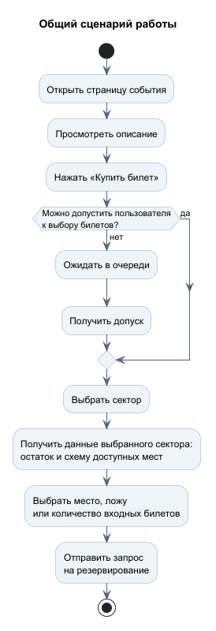
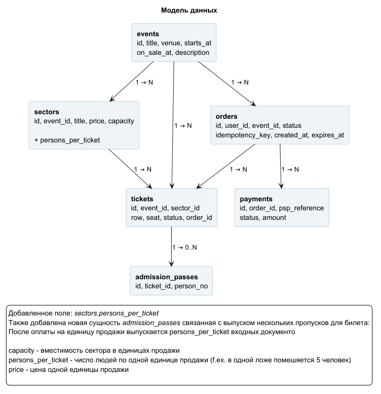
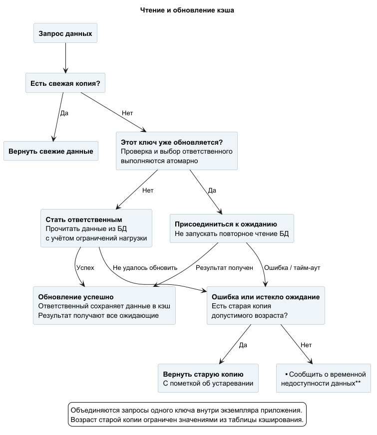
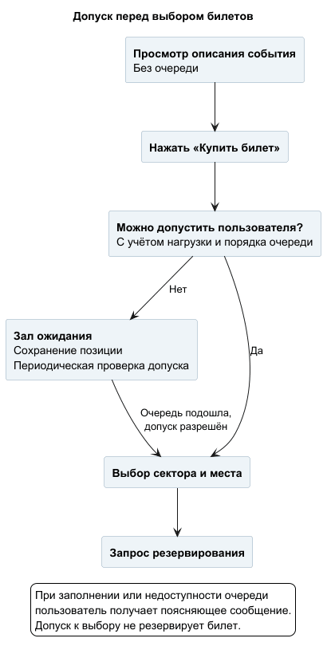

# Работа 1. Путь чтения: страница события

## Решение кратко

В сервисе «Билетёр» описание события и остатки билетов (мест) кэшируются отдельно: у них разные требования к свежести. 

**Ключевое решение:** Количество билетов привязывается к сектору: представим что у нас есть отдельно партер, амфитиатр и тп. При покупке пользователь выбирает желаемый сектор и видет билеты для него.
Соотвественно остаток билетов хранится по паре "событие — сектор" и обновляется по запросу. В течение секунды результат используется повторно, а при ошибке обновления допускается копия возрастом до пяти секунд.

Перед выбором и покупкой билетов действует контролируемый допуск. 
При перегрузке сервера посетители ожидают в порядке поступления, без отображения номера очереди. Просмотр описания остаётся доступным. Допуск к выбору не резервирует место: наличие и цену система проверяет при резервировании.

### Содержание

- [1. Сценарий и исходные допущения](#scenario)
- [2. П. 1.1 - единица инвентаря](#inventory)
- [3. Как кэшируются разные части страницы](#cache)
- [4. Альтернативы и расчёты](#calculations)
- [5. П. 1.2 - наплыв пользователей](#queue)
- [6. Отказы и границы гарантий](#failures)

## 1. Общий сценарий работы

Пользователь открывает страницу события и просматривает его описание.
После нажатия «Купить билет» он переходит к выбору сектора.
При перегрузке системы перед этим переходом пользователь попадает
в очередь ожидания.

Выбор сектора обязателен: после него загружаются количество доступных
единиц продажи и схема мест именно выбранного сектора.

Для нумерованных мест отображаются ряды, номера и доступность кресел.
Для лож — расположение, доступность и вместимость каждой ложи.
Для фан-зоны вместо схемы мест достаточно выбора количества
входных билетов.

Описание события доступно без прохождения очереди. Данные выбранного
сектора запрашиваются при его открытии; автоматического обновления
уже открытой страницы нет.

Выбор места на схеме ещё не означает его резервирование.
Возможность закрепить выбранную единицу за покупателем проверяется
при отправке запроса на резервирование.

Далее представлены условные тестовые числа для дальнейших расчетов

| Параметр | Значение |
| --- | --- |
| Размер события | 10 000 единиц продажи: 20 секторов по 500 |
| Запросы остатков | 5 000 запросов/с, направленных в 5 активно просматриваемых секторов |
| Объединение запросов | Для расчёта рассматривается один экземпляр приложения |
| Ограничение чтений БД | Не более 100 начал чтения/с и 10 одновременно выполняемых чтений для данных страницы |
| Стартовая волна | 10 000 посетителей, без новых поступлений в примере |
| Скорость допуска | До 200 новых посетителей/с при достаточной мощности |

## 2. П 1.1 — единица инвентаря

В одном секторе принят один тип продажи (обычное место/сиденье/ложа). Все ложи внутри одного сектора имеют одинаковую вместимость.

| Тип сектора | Что покупают | Что получают для входа | Что означает остаток |
| --- | --- | --- | --- |
| Нумерованные места | Конкретное кресло с рядом и номером | 1 входной документ | Количество свободных кресел |
| Фан-зона | Право входа одного человека без рассадки | 1 входной документ | Количество доступных входов в пределах вместимости |
| Ложи | Конкретную ложу **целиком** на N человек | N входных документов на одну ложу | Количество свободных лож |

Например, покупка ложи на пять человек уменьшает остаток на **одну ложу**, а не на пять.
На странице может быть написано "_Доступно 5 лож, каждая на 5 человек; цена указана за ложу_". 

Перед оплатой отображаются конкретная ложа, число гостей и полная цена. Это исключает ситуацию  - купил ложу, но непонятно, сколько человек можно провести.

Продавать ложу по отдельным местам не предполгается. Таким образом я решил устроить как модель моего билетера, так и все технические решения.

В каждом входном документе указываются событие, сектор, идентификатор ложи и номер пропуска из общего числа N; в подтверждении покупки - что приобретена ложа целиком на N человек.

Данное решение я выбрал основываясь на личном опыте, по моему опыту если в зале вообще и есть ложи (или какие-то диванчики), то их и продают целиком.

### Модель данных

Исходную модель старался максимально сохранить. Добавлены поле `sectors.persons_per_ticket` и таблица `admission_passes`.

| Сущность | Уточнение                                                                                                                                                                                                         |
| --- |-------------------------------------------------------------------------------------------------------------------------------------------------------------------------------------------------------------------|
| `events`, `orders`, `payments` | Без изменений                                                                                                                                                                                                     |
| `sectors` | `capacity` - вместимость сектора в единицах продажи; `price` - цена одной единицы продажи. Новое поле `persons_per_ticket` определяет число людей по одной единице: 1 для кресла или входа в фан-зону, N для ложи |
| `tickets` | Одна строка - кресло, вход в фан-зону или ложа целиком. Для кресла заполнены `row` и `seat`; ложа определяется по `id`                                                                                            |
| `admission_passes` | Входные документы: `id`, `ticket_id`, `person_no`. После оплаты на каждую проданную единицу выпускается `persons_per_ticket` документов                                                                           |

Например, покупка ложи на пять человек занимает одну строку `tickets` и создаёт пять строк `admission_passes`. Пара `(ticket_id, person_no)` уникальна, чтобы номер пропуска внутри одной единицы продажи не повторялся. Вместимость и условия проданных единиц в рамках этой работы не изменяются.

Остаток сектора — количество свободных единиц продажи. Зарезервированные (`held`) и проданные (`sold`) единицы не учитываются

Остаток мест хранится и показывается отдельно по секторам с понятной подписью: «мест», «входных билетов» или «лож».

## 3. Как кэшируются разные части страницы

### Содержимое и сроки

Кэш общий для всех посетителей. Обозначения: `e` — идентификатор события, `s` — идентификатор сектора.

| Ключ | Значение | Срок свежести | Предельный возраст при сбое |
| --- | --- | ---: | ---: |
| `event:{e}:details` | Название, описание, дата и площадка события | 10 минут | 1 час |
| `event:{e}:sector:{s}:details` | Название сектора, вместимость, число людей по одной единице продажи и цена | 10 минут | 1 час |
| `event:{e}:sector:{s}:availability` | Количество свободных единиц продажи | 1 секунда | 5 секунд |
| `event:{e}:sector:{s}:seats` | Идентификаторы, расположение и статусы мест или лож | 1 секунда | 5 секунд |

Общие сведения меняются редко, поэтому сохраняются свежими дольше.
Остатки и доступность мест меняются быстро - для них срок свежести
составляет одну секунду (согласно заданию в том числе). После его истечения следующий запрос
запускает обновление.

После истечения срока свежести запись не удаляется сразу:
копия остатка сохраняется до пяти секунд с момента получения данных,
чтобы её можно было использовать при ошибке обновления.

Каждая запись дополнительно содержит время получения данных.
При сбое обновления допускается старая копия в пределах указанного
возраста, с пометкой об устаревании. После редактирования общих
сведений соответствующие копии удаляются из кэша.

### Путь чтения

1. Если в кэше есть свежая копия, приложение возвращает её.
2. Если копия отсутствует или устарела, один запрос становится
   ответственным за обновление. Остальные запросы того же ключа
   присоединяются к ожиданию его результата.
3. Ответственный читает данные из БД, сохраняет их в кэш
   и возвращает результат всем ожидающим. Запросы, поступившие
   после обновления, получают уже свежую копию.
4. При ошибке или превышении времени ожидания возвращается старая
   копия, если её возраст ещё допустим, с пометкой об устаревании.
   Если подходящей копии нет, приложение сообщает
   о временной недоступности данных.

Выбор ответственного выполняется атомарно: несколько одновременных
запросов не должны независимо начать обновление внутри одного
экземпляра приложения. Время ожидания ограничено (новый результат за 1с, затем используется старая допустимая копия либо возвращается сообщение о недоступности)

Объединение действует внутри каждого экземпляра приложения,
поэтому разные экземпляры могут одновременно обновлять один ключ.
Обращения к БД дополнительно ограничиваются, чтобы промахи
и отказы кэша не перегрузили базу.

Открытый экран автоматически не обновляется. Новые сведения
загружаются при открытии сектора или повторном запросе пользователя.
Показанная доступность не гарантирует резервирование места.

## 4. Альтернативы и расчёты
### Почему выбрал это решение

| Вариант | Преимущество | Недостаток |
| --- | --- | --- |
| Читать БД при каждом просмотре | Простая логика получения данных | Одинаковые данные запрашиваются многократно, увеличивая нагрузку |
| Кэшировать всю страницу с одним сроком | Единая запись для страницы | Описание и остатки требуют разной свежести |
| Хранить остатки всего события одной записью | Удобно получать информацию по всему залу | При обновлении пересчитываются и те сектора, которые сейчас не просматривают |
| **Кэшировать остатки по секторам и обновлять по запросу** | Пересчитываются только запрашиваемые сектора; результат используется повторно | Больше ключей и отдельных запросов при обновлении нескольких секторов |
| Обновлять кэш по расписанию | Свежие данные могут быть готовы до запроса | Пересчёт выполняется даже для невостребованных секторов |

Выбран кэш по секторам: пользователь обязательно выбирает сектор,
поэтому системе достаточно получить данные именно этой части зала.
Обновление по запросу позволяет не пересчитывать сектора,
которые никто не просматривает.

### Как это снижает нагрузку на БД

Рассмотрим условный пример для одного экземпляра приложения:

- на событии 10 000 единиц продажи в 20 секторах — по 500 в каждом;
- поступает 5 000 запросов на получение кол-ва мест в секунду;
- посетители активно просматривают 5 секторов, остальные в данном примере не запрашиваются (имитируем разную популярность секторов);
- срок свежести кэша - 1 секунда (по условию);
- одновременные запросы одного сектора объединяются.

В установившемся режиме каждый из пяти активных секторов пересчитывается примерно один раз в секунду. 
Остальные запросы используют кэш или присоединяются к уже выполняемому обновлению.

Предполагается индекс по (event_id, sector_id, status).

| Вариант                                            | Подсчёты в БД за секунду | Записи, обрабатываемые при подсчёте |
|----------------------------------------------------| ---: | ---: |
| Без кэша: каждый запрос относится к одному сектору | 5 000 | 5 000 × 500 = 2 500 000 |
| Общий кэш остатков события                         | Около 1 | 1 × 10 000 = 10 000 |
| Кэш по пяти запрашиваемым секторам отдельно        | Около 5 | 5 × 500 = 2 500 |

Кэш позволяет обслужить около 99,9% запросов без отдельного
подсчёта в БД: `1 − 5 / 5 000 = 0,999`.

Разделение по секторам дополнительно уменьшает объём пересчёта:
в этом примере обрабатываются 2 500 записей вместо 10 000,
то есть на 75% меньше. При этом выполняются пять небольших
запросов вместо одного общего.

Выигрыш зависит от того, какие сектора запрашивают.
Если постоянно просматриваются все 20 секторов, суммарный объём
пересчёта составит те же 10 000 записей, но отдельных запросов
будет больше. 
В таком случае общий кэш может все-таки оказаться действительно выгоднее.

## 5. Пункт 1.2 — наплыв пользователей

### Выбранное поведение

Описание события доступно без очереди. После нажатия «Купить билет»
пользователь проходит к выбору сектора либо попадает в зал ожидания,
если система перегружена.

Пользователи допускаются в порядке поступления - FIFO.
Номер позиции не показывается, переход выполняется автоматически.
Сообщение на экране (например): "Сейчас много посетителей. Дождитесь перехода".

| Правило | Поведение |
| --- | --- |
| Проверка допуска | Примерно раз в 5 секунд |
| Обновление страницы | Позиция сохраняется; частые обновления не дают преимущества |
| Закрытие страницы или потеря связи | После 60 секунд без обращений позиция удаляется |
| Ограничение очереди | До 10 000 ожидающих и не более 10 минут ожидания |
| Очередь заполнена или время истекло | Сообщение с предложением повторить попытку позже |

Порядок хранится на сервере, а идентификатор ожидания - в cookie
браузера. Проверки допуска не обращаются к билетной БД.

Скорость допуска учитывает нагрузку от уже вошедших пользователей.
При перегрузке она снижается, а при недоступности БД новый допуск
к покупке останавливается. Обращения уже допущенных пользователей
также остаются ограниченными по нагрузке на БД.

### Расчёт ожидания

Для примера возьмем:

- одновременно пришли 10 000 посетителей;
- система может допускать 200 новых посетителей в секунду;
- мощности достаточно для их дальнейших действий;
- новых поступлений и отказов в этом примере нет.

| Показатель | Расчёт | Результат |
| --- | --- | --- |
| Время выдачи допуска всей волне | 10 000 / 200 | Около 50 секунд |
| Среднее ожидание выдачи допуска | 50 / 2 | Около 25 секунд |
| Проверки очереди при 10 000 ожидающих | 10 000 / 5 | Около 2 000 запросов/с |
| Проверки при интервале 1 секунда | 10 000 / 1 | Около 10 000 запросов/с |

Проверка раз в пять секунд уменьшает число обращений к очереди
в пять раз, но добавляет до примерно пяти секунд на обнаружение
готового допуска, без учёта сетевых задержек.

Если система занята уже вошедшими пользователями,
скорость допуска уменьшается. Если новые посетители приходят быстрее,
чем проходят, очередь растёт до установленного предела.

### Сравнение вариантов

| Вариант | Преимущество | Недостаток                                                                                                                                                                      |
| --- | --- |---------------------------------------------------------------------------------------------------------------------------------------------------------------------------------|
| Отказ "попробуйте позже" | Простая защита от перегрузки, не нужно хранить очередь | При допуске 200 человек/с из первой волны 10 000 посетителей около 9 800 получают отказ в первую секунду и могут повторять запросы. В худшем случае это может и систему сломать |
| **Очередь FIFO без номера** | Управляемый поток и сохранение порядка; обновление страницы не даёт преимущества | Нужно хранить очередь и обслуживать проверки допуска - около 2 000 запросов/с в примере                                                                                         |
| Очередь с номером | Пользователь видит своё положение | Нужно обновлять позицию; сам номер не гарантирует время ожидания                                                                                                                |

Выбрана очередь FIFO без номера: она ограничивает поток
и позволяет дождаться перехода без постоянных ручных попыток.

Допуск к выбору не закрепляет конкретное место. Оно считается
зарезервированным только после успешного ответа сервера.

## 6. Отказы и ограничения решения

Данные результаты - это сумма всех ситуаций описанных в рамках первой лабы и отображающие работу системы на момент этой же - 1ой - лабораторной)

| Ситуация | Действие системы | Что видит пользователь |
| --- | --- | --- |
| Копия отсутствует или устарела | Один запрос обновляет данные, остальные ждут результат | Краткое ожидание, затем данные |
| Обновление завершилось ошибкой или ожидание истекло | Возвращается старая копия допустимого возраста; если её нет — сообщение о недоступности | Пометка об устаревании либо сообщение, но не ложный нулевой остаток |
| Кэш полностью недоступен | Чтения БД ограничиваются, допуск новых пользователей сокращается | Более долгое ожидание или временная недоступность данных |
| БД недоступна | Новые допуски к покупке останавливаются; сохранённые данные показываются только в пределах допустимого возраста | Доступное описание из кэша и сообщение о недоступности покупки |
| Механизм очереди недоступен | Новые допуски приостанавливаются, уже допущенные запросы остаются под ограничениями нагрузки | Сообщение о временной недоступности перехода к покупке |

Истечение срока кэша — штатная ситуация, а не отказ.
Если недоступно само хранилище кэша, рассчитывать на получение
старой копии из него нельзя.

### Итого

Решение снижает повторные чтения БД, ограничивает нагрузку
и определяет допустимый возраст данных. При этом открытая страница
может устаревать, а показанное свободное место не гарантирует
успешного резервирования.

Для проверки достаточно отслеживать число обращений к БД,
долю ответов из кэша, время получения данных и длину очереди.
Расчёты основаны на учебных допущениях; фактические пределы нагрузки
определяются тестированием.

---

[К списку лабораторных](../README.md) · [Исходники схем](puml/)
