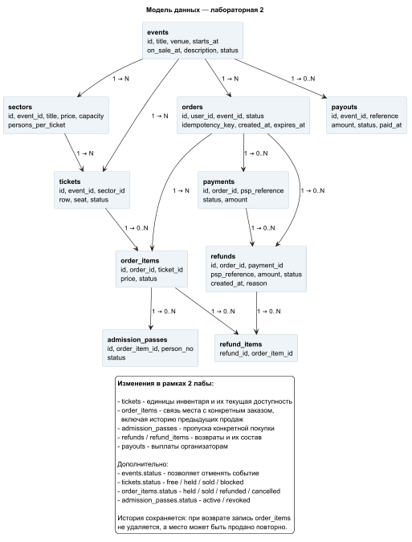
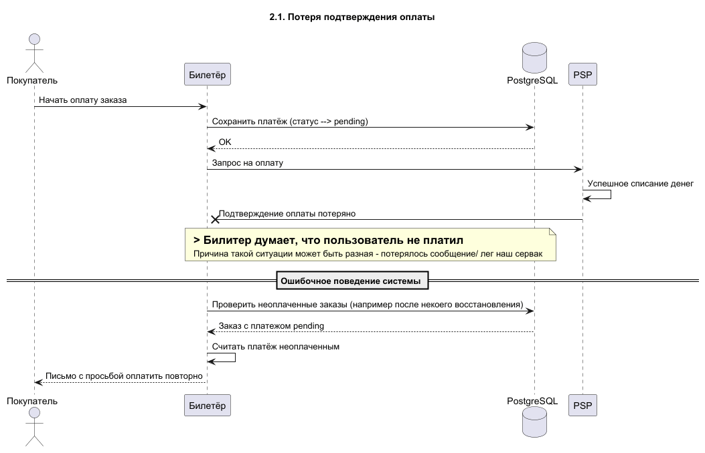
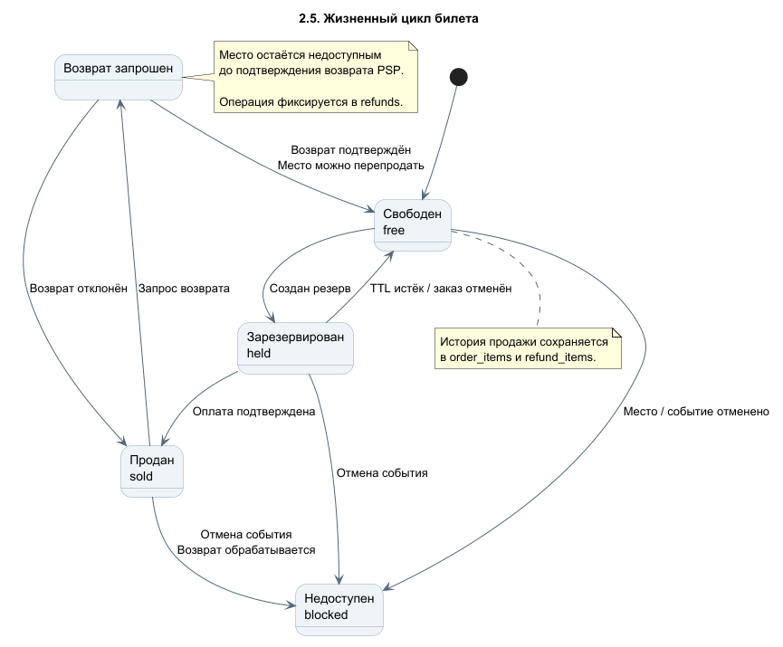
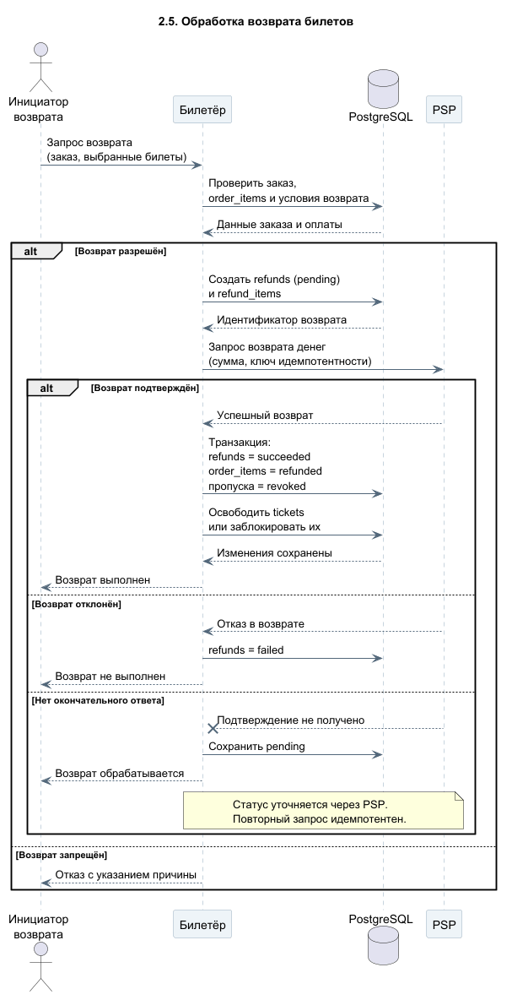

# Лабораторная работа №2. Путь записи: не продать одно место дважды

## 1. Общее архитектурное решение

---

В начале лабораторной стоит сказать один момент: в процессе ее выполнения я столкнулся с рядом существенных косяков,
в следствии чего пришлось изменить схему Базы Данных

Ниже представлена новая БД, в том числе с изменениями, необходимыми для закрытия вопросов 2.4 - 2.5
(подробнее об их рещении в соответствующих блоках)

---

### 1.1. Данные и источник истины

Основное хранилище - PostgreSQL. Оно хранит заказы, платежи и актуальное состояние единиц инвентаря. Кэш и очередь из первой лабораторной помогают выдерживать нагрузку, но не определяют, кому принадлежит место.

Используем обновлённую модель:

| Сущность | Назначение |
|---|---|
| `events`, `sectors` | События, сектора и параметры продажи |
| `tickets` | Продаваемые единицы: место, вход в фан-зону или VIP-ложа целиком; `status` |
| `order_items` | Позиции заказа, связывающие `tickets` с конкретными `orders`; сохраняют историю покупок и возвратов |
| `orders` | Заказ пользователя; `user_id`, `status`, `created_at`, `expires_at`, `idempotency_key` |
| `payments` | Платёжные операции, связанные с заказом; собственный статус, сумма, идентификатор PSP |
| `admission_passes` | Индивидуальные разрешения на проход, связанные с `order_items` и создаваемые после оплаты; у одной VIP-ложи может быть несколько пропусков |
| `refunds`, `refund_items` | Операции возврата и конкретные позиции заказа, по которым возвращаются деньги |
| `payouts` | Выплаты организаторам мероприятий, их суммы и статусы |

Один `order` может объединять несколько `tickets` через `order_items`. При возврате и повторной продаже места предыдущая запись в `order_items` сохраняется. Статусы заказа и платежа независимы: например, отменённый заказ может временно иметь платёж с неизвестным результатом.

### 1.2. Резервирование

1. Выбор места в интерфейсе ещё не создаёт резерв.
2. При нажатии "Продолжить" сервер создаёт заказ, соответствующие `order_items` и пытается зарезервировать **все** выбранные единицы инвентаря в одной транзакции PostgreSQL.
3. Применяем условный переход `tickets: free → held`  (+ все зависимые элементы)
4. Если хотя бы одна единица недоступна, транзакция откатывается полностью. Частичный резерв заказа не создаётся.
5. При дальнейших операциях через `order_items` проверяем, что удерживаемые билеты связаны именно с этим заказом.

Таким образом, два параллельных покупателя не смогут успешно закрепить одну и ту же единицу инвентаря.

### 1.3. TTL резерва

- **Первые 10 минут** после создания резерва - срок для начала оплаты.
- Начало оплаты фиксируется **атомарно**, пока первоначальный срок ещё не истёк. Заказ переходит в проектное состояние `payment_pending`.
- Обычная обработка платежа рассчитана ориентировочно на **5 минут**; если результат неизвестен, выполняется дополнительная сверка.
- Абсолютный срок удержания - **30 минут от `orders.created_at`**, даже если PSP не отвечает. Начало оплаты этот предел не сдвигает.

Для этого `orders.expires_at` обозначает **абсолютное время окончания удержания** (`created_at + 30 минут`). Предел для начала оплаты проверяем отдельно: `created_at + 10 минут`.

По достижении абсолютного срока сервер отменяет незавершённый заказ и в транзакции освобождает его билеты (`held → free`) + order_items -> cancelled
Отдельный фоновый обработчик периодически находит такие заказы по `expires_at`; после перезапуска он повторно проверяет просроченные записи. Проверка срока также обязательна при попытке завершить продажу, чтобы задержавшаяся очистка не позволила оплатить уже истёкший резерв. 
Если сервер недоступен в момент истечения TTL, физическое изменение строк произойдёт после восстановления, но истёкший резерв уже не должен давать права завершить покупку.

### 1.4. Работа с внешним платёжным сервисом (PSP)

- `orders` и `payments` имеют отдельные состояния. Наличие запроса к PSP само по себе не означает успешную оплату.
- Для активной платёжной попытки сохраняем устойчивый идентификатор и используем **тот же ключ идемпотентности** при повторных обращениях к PSP (при поддержке провайдером).
- Повторное нажатие кнопки оплаты не должно создавать вторую активную попытку; конкурентное создание попыток также защищается на стороне БД.
- Проверяем, что подтверждённый платёж относится к нужному заказу, а его сумма и валюта соответствуют полной стоимости заказа. Частичную оплату заказа не поддерживаем.
- Подтверждение оплаты принимается от PSP или получаем при серверной проверке его состояния, а не доверяем сообщению клиентского интерфейса.
- Потерянный ответ и сетевой таймаут не считаем отказом в оплате. Система повторно проверяет результат по идентификатору операции.
- При неопределённом результате пользователь видит сообщение о проверке платежа, а не предложение немедленно оплатить ещё раз.

### 1.5. Завершение покупки и выдача

При подтверждённом успешном платеже, если заказ ещё действителен, в одной транзакции PostgreSQL:

1. Проверяем состояние заказа, срок удержания, состав заказа и связь билетов с заказом через `order_items`.
2. Фиксируем подтверждённый результат платежа.
3. Переводим заказ в `paid`, связанные `order_items` и соответствующие `tickets` — в `sold`.
4. Создаём `admission_passes`, связанные с соответствующими `order_items`.
5. Выполняем `COMMIT`.

Если какая-либо операция не проходит, изменения транзакции откатываются целиком. Повторное подтверждение от PSP не должно создавать повторную продажу или дублирующие пропуска.

### 1.6. Сбои, сверка и позднее подтверждение

- Фоновая обработка периодически (и после перезапуска в случае сбоев) проверяет незавершённые платёжные операции, в том числе связанные с уже отменёнными заказами
- Если PSP подтверждает успешную оплату и заказ ещё действителен, система повторяет безопасное завершение продажи
- Если истекли максимальные 30 минут, заказ отменяется, а места освобождаются **независимо от доступности PSP**. Отмена заказа не равна доказательству, что PSP не списал деньги
- Если PSP позднее подтверждает списание по отменённому заказу, заказ **не восстанавливается**, уже освобождённые места не изымаются у других покупателей; запускается возврат денег
- Если результат отмены или возврата неизвестен, операция остаётся незавершённой для последующей сверки
- Для сверки сохраняем состояние и идентиф. операций в БД

### 1.7. Проверка инвариантов

| Инвариант                                                                                                     | Как обеспечивается                                                                                                                                             | Как обнаруживаем проблему и восстанавливаемся                                                                                                                                |
|---------------------------------------------------------------------------------------------------------------|----------------------------------------------------------------------------------------------------------------------------------------------------------------|------------------------------------------------------------------------------------------------------------------------------------------------------------------------------|
| **И1.** Ни одно место не продано дважды; у билета не более одной активной связи с заказом через `order_items` | Всегда атомарно переводим `tickets.status` в соотвествующий статус held и создаем связи с `order_items`; при продаже всегда проверяем связь с заказом, статусы | Если место уже занято или связано с другим действующим заказом, операция не выполняется и транзакция откатывается. Пользователь получает актуальную информацию о доступности |
| **И2.** Каждый оплаченный заказ содержит все положенные ему билеты                                            | `paid`, статусы `sold` у `tickets` и `order_items`, создание `admission_passes` фиксируются в одной транзакции                                                 | Незавершённую продажу после сбоя находим через платёжную сверку и безопасно повторяем, пока заказ действителен                                                               |
| **И3.** Резерв не удерживается сверх TTL                                                                      | Абсолютный предел 30 минут; проверки `expires_at` и фоновая очистка                                                                                            | Просроченные `held` переводятся в `free` после восстановления; истёкший резерв не даёт права завершить покупку                                                               |
| **И4.** Оплата соответствует выданным билетам                                                                 | Полная сумма заказа, проверка ответа PSP, одна активная попытка, атомарная выдача                                                                              | Расхождение с PSP выявляется сверкой; при позднем списании по отменённому заказу инициируется возврат                                                                        |

### 1.8. Согласованный внутренний SLO

**Цель:** не менее 99% подтверждённых оплат должны приводить к фиксации билетов и `admission_passes` в PostgreSQL в течение 60 секунд после получения сервером достоверного подтверждения PSP.

Это внутренний SLO выдачи в БД. Требование задания 2.3 относится к пути "оплата → билет у пользователя"; пользовательскую доступность и задержку доставки определим отдельно при ответе на 2.3.

---

## 2. Ответы на вопросы лабораторной

### 2.1. Повторная просьба оплатить после успешного списания

Проблема может возникнуть в том случае, если до нашего приложения не дошло потверждение оплаты
В бд останется запись о неоплаченном заказе => если не сверить статусы оплаты, система попросит повторно

У меня это решается следующим образом:
Мы сохраняем id платежной операции и при потере подтверждения / восстановлении системы у всех
"pending" заказов проверяем их состояние у PSP

Дополнительно используется ключ идемпотентности, чтобы повторные запросы не создавали новое списание. 
При подтверждении успешной оплаты система завершает действующий заказ; если резерв уже истёк и заказ отменён, инициирует возврат.

### 2.2. Бронь отменена, но деньги списаны

* (a) - именно на оплату у нас 10 минут дается, максимум 30 минут удержания; отмененные заказы восстановлению не подлежат
* (b) - после отмены продолжаем сверять платеж с PSP; сам заказ будет cancelled, но payment penidng -> можно понять что результата так и не было;
по необходимости инициируем возврат
* (c) - освобождённое место может быть перепродано; новый покупатель его сохраняет, а первому возвращаем деньги

### 2.3. Билет получен через восемь часов

За 60 секунд после успешной оплаты не менее 99% покупателей должны получить доступ к билетам в личном кабинете и на странице заказа.

После подтверждения оплаты билеты и admission_passes фиксируются в БД и становятся доступны пользователю. Отправка билетов на почту может выполняться отдельно и не должна влиять на их доступность в системе.

Для контроля используем статусы orders, order_items и наличие соответствующих admission_passes. 
Если выдача задерживается, система проверяет состояние платежа и заказа, при необходимости повторяет завершение покупки.

При массовых задержках временно приостанавливаем новые продажи, а обработку уже оплаченных заказов продолжаем в приоритетном порядке.

### 2.4. Деньги у организатора или у оператора?

В изначальной системе мы не могли достоверно определить, у кого находятся деньги и был ли выполнен возврат. Для этого необходимо отслеживать не только оплату заказов, но и остальные финансовые операции.

Поэтому в новую модель БД добавлена таблица payouts, которая хранит информацию о выплатах организаторам: суммы, статусы, идентификаторы операций и время перечисления.

Вместе с payments и refunds это позволяет отслеживать весь "путь" денег: оплату покупателем, перечисление организатору и возможный возврат.

При возникновении спорной ситуации мы сопоставляем сохранённые операции с данными PSP и банковскими подтверждениями. На их основе поддержка может быстро сформировать отчёт по заказу и определить, какие операции действительно выполнены, а какие ещё находятся в обработке.

### 2.5. Обратный путь: возвраты

Для задания 2.5 сделал две общие диаграммы процесса возврата. 
Также при выполнении этого пункта пришлось изменить предыдущую модель БД, поскольку изначально она не предусматривала полноценную историю возвратов и повторных продаж.

Здесь показаны общие возможные переходы и состояния системы

Здесь показан общий процесс возврата: проверка запроса, создание операции refunds, обращение к PSP и обновление данных после получения результата.

Сам механизм возврата практически одинаковый, но в зависимости от инициатора и причины отличаются дальнейшие действия.

1. Возврат покупателем

Покупатель может вернуть весь заказ или только отдельные билеты.

Для этого добавлены таблицы refunds и refund_items. Первая хранит информацию о финансовой операции и её статусе, а вторая связывает возврат с конкретными order_items. Это позволяет возвращать деньги только за выбранные позиции заказа.

После подтверждения возврата PSP соответствующие order_items получают статус refunded, пропуска аннулируются, а места в tickets снова становятся free. Исходная оплата остаётся в истории, как и все операции возврата.

2. Возврат по инициативе организатора

Организатор может отменить отдельные проданные места, например если они стали недоступны для посещения.

Процесс возврата денег остаётся тем же, но соответствующие места переводятся в blocked, чтобы исключить их повторную продажу. Действующие пропуска аннулируются, а покупателям оформляются возвраты.

3. Отмена всего мероприятия

При отмене мероприятия events.status становится cancelled, а дальнейшие продажи прекращаются.

Все места мероприятия становятся недоступными, действующие пропуска аннулируются. Для оплаченных позиций, по которым ещё не был выполнен возврат, создаются refunds и соответствующие refund_items.

Возвраты отправляются в PSP, а их статусы отслеживаются до подтверждения результата.

#### Сроки возврата

Возврат инициируется после одобрения запроса или принятия решения об отмене. Пока PSP не подтвердил результат, операция остаётся pending. Фактический срок поступления денег покупателю зависит от платёжного провайдера и банка.